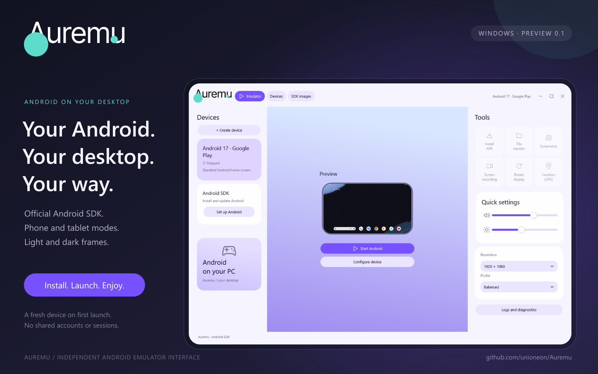
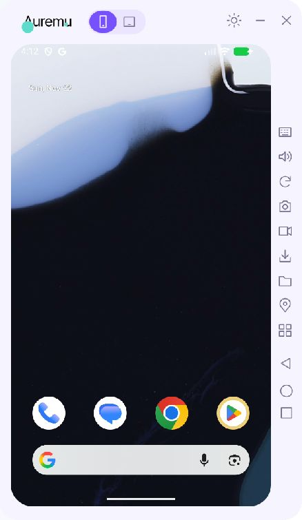
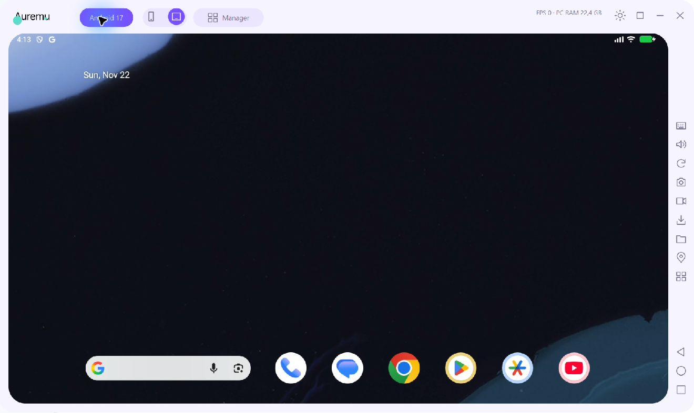
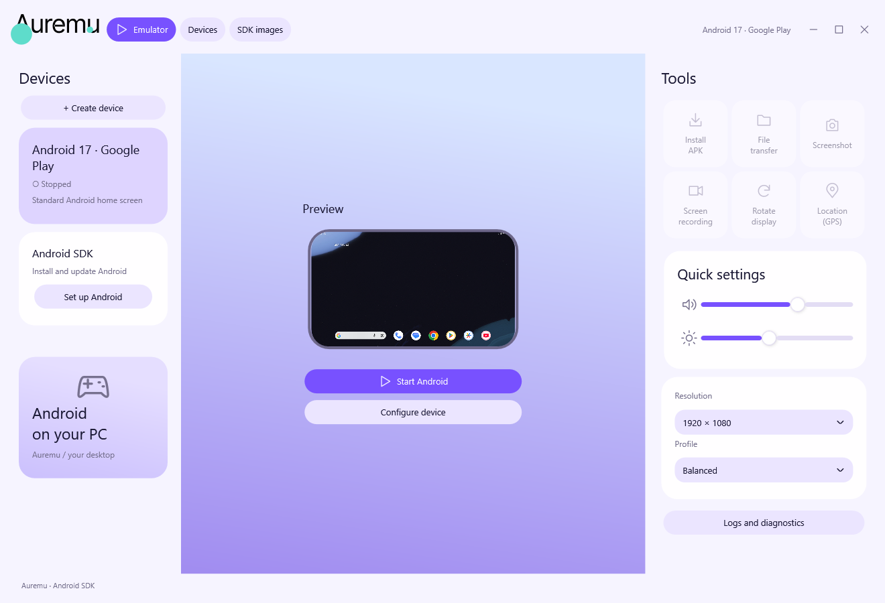
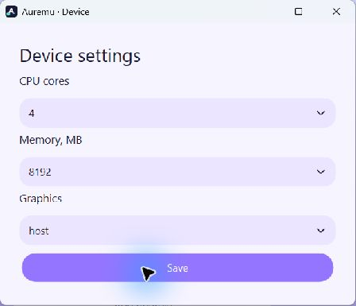

<p align="center"></p>

<p align="center"><strong>Your Android. Your desktop.</strong><br>A Windows interface for the official Android Emulator.</p>

<p align="center">
<a href="https://github.com/unioneon/Auremu/releases/download/v0.1.1/Auremu-0.1.1-windows-x64-setup.exe"></a>&nbsp;&nbsp;
<a href="https://github.com/unioneon/Auremu/releases/download/v0.1.1/Auremu-0.1.1-windows-x64-portable.zip"></a>
</p>

<p align="center">Windows 10/11 x64 · Android 17 · Phone & tablet · Preview<br>
<a href="https://github.com/unioneon/Auremu/releases/latest">Release notes & checksums</a> · <a href="#first-launch">First launch</a> · <a href="#device-settings">Device settings</a> · <a href="https://github.com/unioneon/Auremu/issues">Report an issue</a></p>

## Android in a desktop frame

The standard Android home screen and Google Play in a Windows window, with phone
and tablet modes, light and dark frames, rounded screen edges and a compact side
toolbar. Install APKs, transfer files, take screenshots, record the screen and
send GPS coordinates from the manager.

Auremu uses the **official Android Emulator** for virtualization and **scrcpy**
for display and input. It is an independent application, not a new hypervisor or
an official Google product.

## Running Android

Real screenshots of Android running inside Auremu, with the English desktop UI.

### Phone mode

<p align="center"><a href="docs/android-phone.jpg"></a></p>

### Tablet mode

<p align="center"><a href="docs/android-tablet.jpg"></a></p>

## Download

| Package | How to use it | Where Android data lives |
|---|---|---|
| **Installer EXE** | Installs for your Windows account; adds a Start menu shortcut | `%LOCALAPPDATA%\Auremu\data` |
| **Portable ZIP** | Extract the complete archive, then open `Auremu.cmd` | `data` beside `bin` and `runtime` |

Both packages include Auremu and its display module. **Android downloads
separately on first launch.** No account, saved device or session is included.
SHA-256 checksums accompany the release. These preview builds are unsigned;
performance and compatibility vary by PC. 60 FPS is not guaranteed.

## First launch

1. Enable CPU virtualization in BIOS/UEFI and **Windows Hypervisor Platform** in Windows Features. Restart Windows after changing these features.
2. Install Auremu or extract the complete portable ZIP into a writable folder.
3. In the first-run wizard, read the Android SDK terms, tick the acceptance box and choose **Install Android**.
4. Wait for SDK Tools, Temurin JDK 21, Emulator, ADB and **Android 17 Google Play x86_64** to download. Auremu creates a fresh `Auremu_Android_17` device.
5. Select **Start Android**. The first cold boot takes longer than subsequent Quick Boot starts.

Internet and **at least 15 GB of free space** are required. Android Studio is
not needed. You can connect an existing SDK with Command-line Tools, Emulator,
platform-tools and the required image. SDK tools need JDK 21 through `JAVA_HOME`
or a JDK in the `java` folder beside the SDK folder.

**Requirements:** Windows 10/11 x64, .NET Framework 4.8, Intel/AMD CPU with
hardware virtualization and WHPX. 16 GB of system RAM is recommended.
Windows on ARM is not supported in this release.

[Official acceleration guide](https://developer.android.com/studio/run/emulator-acceleration)
· [Android SDK terms](https://developer.android.com/studio/terms)

## Device settings

Select **Manager** in the top bar, then **Configure device**
beneath the preview. Choose CPU cores, RAM and graphics,
then **Save**. Changes apply on the next Android start; saving does
not change the memory of an already running virtual machine.

<p align="center"></p>
<p align="center"><br><sub>Configure CPU cores, Android RAM and the graphics backend, then save and restart Android.</sub></p>

| Setting | Purpose | Starting point |
|---|---|---|
| CPU cores | Virtual CPU count | 4 cores |
| Memory, MB | RAM assigned to Android | 4096 MB; leave RAM available for Windows |
| Graphics | Rendering backend | `auto`; try `host` for GPU rendering or `software` for compatibility |
| Phone / tablet | Android display shape | Two device buttons in the top bar |
| Android SDK | Tool installation and updates | **SDK images** in the manager top bar |

The manager's right panel contains APK install, file transfer, screenshot,
recording, rotation and GPS controls. In the player, use the side toolbar for
these actions and **Back**, **Home**, **Recent apps** near its lower edge.

## Performance and troubleshooting

The FPS counter reports the **scrcpy capture stream**, not a game benchmark.
Frames are produced when Android's screen changes, so a static desktop can
report a low value or zero. Measure performance while content is moving.

If Android does not start, check WHPX, BIOS virtualization, free RAM and disk
space, then open **Logs and diagnostics** in the manager.
Try `auto` or `software` graphics for GPU driver issues. Stop Android before SDK
updates. Quick Boot retries once with a cold start if snapshot restoration fails;
it does not wipe the device.

For issue reports, include Windows version, CPU/GPU, Auremu version and an
anonymized log excerpt. Do not upload device images, accounts or ADB keys.

## Your data stays separate

Release packages are built from an explicit list of program files. They contain
no AVDs, snapshots, accounts, ADB keys, personal settings or saved sessions.
Auremu adds no advertising SDK or analytics service. **The Google Play image
includes Google services** with their own terms and network activity; this is
not described as tracker-free Android.

Uninstalling preserves `%LOCALAPPDATA%\Auremu\data`. Deleting the entire portable
folder also deletes its Android data. Do not share your `data` folder.
Developers can set `AUREMU_DATA_DIR` for an isolated data directory.

## Build from source

Use Windows and the .NET Framework 4.8 compiler. Node.js is not needed to build the app.

```powershell
.\build.ps1
.\tests\run.ps1
.\packaging\build-release.ps1
.\tests\check-release.ps1
```

Packaging downloads official scrcpy 5.0.1, verifies its pinned SHA-256, then
creates an installer, portable ZIP and checksums in `artifacts`. To reuse an
existing vendor distribution, pass `-ScrcpyDirectory C:\path\to\scrcpy-win64-v5.0.1`.
The app builds into `dist`; `start.cmd` runs the development build. GitHub Actions
runs the same build and package checks on Windows.

Tests cover SDK protocol fixtures, AVD isolation, process failures, frame
geometry, smooth corners and release contents. They do not replace real Android
testing across different PCs. See [CHANGELOG.md](CHANGELOG.md) for limits.

| Folder | Contents |
|---|---|
| `src` | WPF app and Android runtime integration |
| `assets` | Brand files and approved frame geometry |
| `packaging` | Per-user installer and portable packaging |
| `tests` | SDK, layout, corner and package checks |
| `docs` | Product preview and screenshots |

## Components and terms

[THIRD-PARTY-NOTICES.md](THIRD-PARTY-NOTICES.md) lists scrcpy dependencies,
SDK terms and JDK information. Auremu is not affiliated with Google or Genymobile.
Source is published for inspection; this release does not grant a general
open-source license to the Auremu code or branding.
